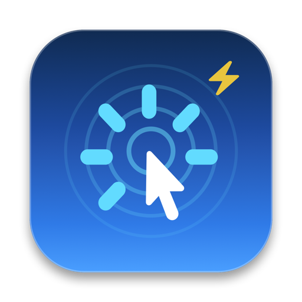

# AutoClicker for macOS

<p align="center">
  
</p>

<p align="center">
  <strong>A lightweight, zero-dependency automation workflow builder for macOS.</strong><br>
  Built with Swift & SwiftUI • Designed by Satheesh Akula
</p>

<p align="center">
  
  
  
  
  
</p>

---

## 📖 Overview

**AutoClicker** is a native, modern macOS desktop utility designed to automate repetitive keyboard and mouse workflows across any desktop application (e.g. video editors like Adobe Premiere Pro, data entry software, browser tasks, and creative tools).

Unlike traditional Python-based auto-clickers that rely on fragile virtual environments (`pyautogui`, `pynput`) that break whenever macOS or Homebrew updates, **AutoClicker** is built using native macOS **SwiftUI**, **AppKit**, and **CoreGraphics**. It requires **zero external packages or runtime installations** and runs on any Mac running **macOS Sonoma (14.0+)** or newer.

---

## ✨ Features

- **Dynamic Multi-Step Routine Builder**:
  - Starts with 5 customizable steps by default.
  - Add, delete, duplicate, and reorder steps dynamically.
  - **Enable / Disable Toggle**: Temporarily mute individual steps without deleting them.

- **5 Versatile Step Actions**:
  1. ⌨️ **Keystroke**: Trigger single keys (letters, numbers) or special keys (`Down Arrow`, `Up Arrow`, `Return`, `Space`, `Tab`, `Escape`).
  2. ⌘ **Keystroke with Modifiers**: Combine keys with modifier combinations (**⌘ Cmd**, **⌥ Opt**, **⌃ Ctrl**, **⇧ Shift**) with live combo badges (e.g. `⌘ + ⇧ + S`).
  3. 🖱️ **Mouse Left Click**: Click at the **current mouse position** or at **specific screen coordinates $(X, Y)$**. Supports single and double clicks.
  4. 🖱️ **Mouse Right Click + Context Menu Selection**: Right-click at $(X_1, Y_1)$ to open a context menu, pause for menu animation, and automatically left-click the chosen menu option at $(X_2, Y_2)$.
  5. ⏱️ **Delay Timer**: Set precise pauses (0.1s to 30.0s) between actions.

- **Interactive "🎯 Pick Coordinates" Tool**:
  - Never guess screen pixel numbers! Click **"Pick"** on any mouse step $\rightarrow$ hover your cursor over the target button or menu item $\rightarrow$ press **Spacebar** or **Click** to lock the coordinates instantly.

- **Intelligent Window Minimization**:
  - **Auto-Minimize on Start**: The moment you start the routine, AutoClicker minimizes to the Dock so your workspace is unobstructed.
  - **Auto-Restore on Stop**: When finished or when you press **ESC**, the window automatically restores and displays the completion summary.

- **Universal Timing & Repetition Control**:
  - **Universal Step Delay**: Set a global interval applied between every step.
  - **Pre-Start Countdown**: Configurable countdown (default: 3.0s) allowing you to switch focus to your target application.
  - **Repetition Modes**: Run continuously in an infinite loop or set a fixed repetition count.
  - **Emergency Stop (ESC)**: Sliced 20ms polling ensures pressing **ESC** anywhere on your Mac instantly halts the automation.
  - **Global Hotkey**: Press **`F6`** (or `⌘ + R`) to start the routine.

- **Save & Load Profiles (`.json`)**:
  - Export and import customized routines to `.json` files (e.g. `Premiere Pro auto color.json`) so you can switch between workflows effortlessly.

---

## 🖥️ User Interface Preview

```text
┌────────────────────────────────────────────────────────────────────────┐
│  [❖] AutoClicker Workflow              Cycle: 3 (Infinite)   [STOP (ESC)] │
│      ● Routine running. Press ESC to stop.                             │
├────────────────────────────────────────────────────────────────────────┤
│  [✓] [⌨] Step 1  [ Keystroke ▼ ]                              [↑] [↓] [⧉] [🗑]│
│      Key: [ down ]   [ Presets ▼ ]   (letter or name: down, return)     │
├────────────────────────────────────────────────────────────────────────┤
│  [✓] [⌘] Step 2  [ Keystroke with Modifiers ▼ ]               [↑] [↓] [⧉] [🗑]│
│      Modifiers: [✓ ⌘ Cmd] [ ⌥ Opt ] [ ⌃ Ctrl ] [ ⇧ Shift ]             │
│      Key: [ d ]   Combo: ⌘ + D                                         │
├────────────────────────────────────────────────────────────────────────┤
│  [✓] [🖱] Step 3  [ Mouse Left Click ▼ ]                       [↑] [↓] [⧉] [🗑]│
│      Position: (●) Current Cursor   (○) Coordinates (X, Y)             │
├────────────────────────────────────────────────────────────────────────┤
│  [✓] [⏱] Step 4  [ Delay Timer ▼ ]                            [↑] [↓] [⧉] [🗑]│
│      Wait Duration: ────●──────────── [ 0.50 ] seconds                 │
├────────────────────────────────────────────────────────────────────────┤
│  [ + Add Step ]                                     [ Reset 5 Steps ]  │
├────────────────────────────────────────────────────────────────────────┤
│  Universal Step Delay: [──●──] 0.50 s    Start Countdown: [──●──] 3.0 s│
│  Repeat: (●) Until ESC   (○) Fixed Count       [Save...]   [Load...]   │
├────────────────────────────────────────────────────────────────────────┤
│                       Designed by Satheesh Akula                       │
└────────────────────────────────────────────────────────────────────────┘
```

---

## 📦 Installation & Getting Started

### Option 1: Run the Pre-Built App (Zero Setup)
1. Double-click **`AutoClicker.app`** in Finder.
2. (Optional) Drag `AutoClicker.app` into your `/Applications` folder.

### Option 2: Compile from Source
Prerequisites: A Mac with macOS Sonoma 14.0+ and Command Line Tools (`clang` / `swiftc`).
```bash
git clone https://github.com/SatheeshAkula/AutoClicker-macOS.git
cd AutoClicker-macOS

# Build both GUI and CLI binaries
make

# Install App to ~/Applications
make install-app
```

---

## 🔒 macOS Accessibility Permission

macOS requires **Accessibility** permission for any utility that simulates keyboard or mouse input:

1. Open **System Settings $\rightarrow$ Privacy & Security $\rightarrow$ Accessibility**.
2. Toggle **ON** the switch next to **AutoClicker** (or **Terminal** if running the CLI version).
3. If not yet enabled, macOS will automatically prompt you with a dialog on the first run.

---

## ⌨️ CLI Companion Tool (`autoclicker`)

A standalone C binary is also included for headless or script-driven automation:

```bash
./autoclicker [options]
```

### Options:
| Flag | Description | Default |
| :--- | :--- | :--- |
| `-i, --initial <sec>` | Initial delay before starting | `3.0` s |
| `-s, --step <sec>` | Delay after each step | `0.5` s |
| `-n, --count <num>` | Number of cycles to run | `0` (Infinite) |
| `--dry-run` | Print actions without sending actual inputs | Disabled |
| `-h, --help` | Display usage and help message | — |

---

## 🛠️ Project Structure

```
AutoClicker/
├── AutoClicker.app         # Double-clickable macOS Application Bundle
├── AutoClickerGUI          # Universal GUI Mach-O binary
├── autoclicker             # Universal CLI Mach-O binary
├── AutoClicker.command     # Terminal launcher script
├── AutoClickerApp/         # Full Swift & SwiftUI source code
│   ├── AutoClickerApp.swift    # App entry point & lifecycle
│   ├── ContentView.swift       # Main window view & toolbar
│   ├── StepRowView.swift       # Context-sensitive step card
│   ├── CoordinatePicker.swift  # Floating coordinate picker HUD
│   ├── RoutineRunner.swift     # Background execution engine & hotkeys
│   ├── RoutineViewModel.swift  # Profile & step state management
│   ├── InputSimulator.swift    # CoreGraphics event simulation
│   ├── Models.swift            # Data models & Codable definitions
│   ├── generate_icon.swift     # App icon generation script
│   ├── AppIcon.icns            # Multi-resolution macOS icon
│   ├── AppIcon_Preview.png     # High-res PNG icon preview
│   └── Info.plist              # Bundle metadata (minos: 14.0)
├── build_gui.sh            # GUI compilation script
├── autoclicker.c           # Pure C CLI implementation
├── Makefile                # Unified build system
├── LICENSE                 # MIT License
└── README.md               # Project documentation
```

---

## 👨‍💻 Author & Attribution

- **Architect & Designer**: Satheesh Akula
- **Platform**: macOS 14.0+ (Sonoma, Sequoia, and newer)
- **License**: [MIT License](LICENSE)
